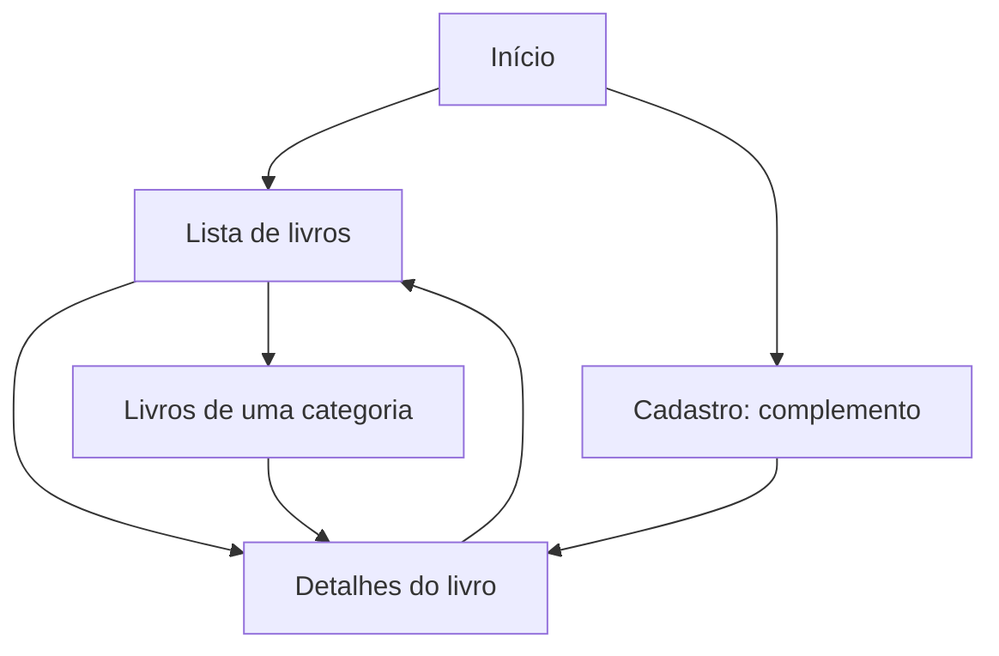
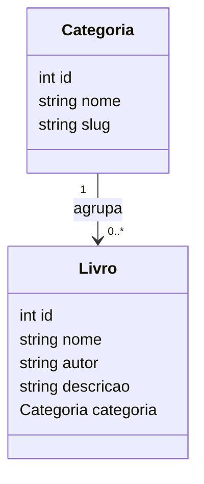
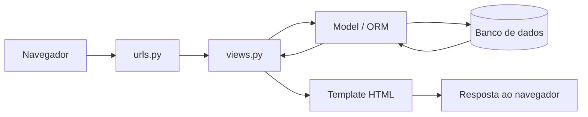

# Lista 7: começar o projeto

Vamos usar a **Estante da Turma** como exemplo. A ideia é terminar um projeto pequeno que você consiga explicar. Nesta primeira etapa, concentre-se na página inicial, nos dados e na listagem. A lista 8 vai continuar esse trabalho.

Para escrever e executar os arquivos aos poucos, comece pela [etapa 1 do roteiro](passo-a-passo.md#etapa-1-lista-7-início-e-livros-do-banco). Este guia organiza as respostas na ordem das questões.

## Questão 1: escolher o problema

**a) Nome:** Estante da Turma.

**b) Problema:** os alunos querem conhecer livros indicados pelos colegas, mas as indicações ficam espalhadas nas conversas. O catálogo reúne nome, autor, descrição e categoria em um só lugar, facilitando encontrar um livro para ler.

**c) Público-alvo:** alunos e professores da turma.

**d) Três funcionalidades principais:** listar livros, consultar seus detalhes e filtrar por categoria. Para começar a lista 7, os livros podem ser cadastrados pelo Admin. Depois acrescentaremos um formulário na página.

**e) Fora do escopo inicial:** empréstimos e reservas, contas individuais e avaliações dos livros. Assim conseguimos terminar o catálogo antes de aumentar o projeto.

O objetivo é permitir que um aluno encontre uma indicação de leitura e saiba quem escreveu o livro.

## Questão 2: requisitos e navegação

Requisito é uma frase que diz o que esperamos do sistema. Os requisitos funcionais descrevem ações:

1. O usuário poderá abrir a página inicial.
2. O sistema deverá listar os livros com nome e autor.
3. O usuário poderá consultar os detalhes de um livro.
4. O usuário poderá ver os livros de uma categoria.
5. O administrador poderá cadastrar categorias e livros pelo Admin.
6. No complemento, o usuário poderá cadastrar um livro pelo formulário.

Os requisitos não funcionais dizem como queremos que o sistema se comporte: os textos devem ser legíveis no celular e no computador; as páginas devem ter links claros para voltar à lista e ao início.

O mapa inclui as páginas que serão concluídas na lista 8 e no complemento:



**Cenário de uso:** Ana abre o início, clica em “Conhecer os livros”, escolhe “Ficção” e abre um livro. Ela lê o autor e a descrição e volta para a lista pelo link da página.

## Questão 3: modelar os dados

Uma entidade é algo sobre o qual queremos guardar informações. Aqui temos **Categoria** e **Livro**.

| Entidade | Atributo | Tipo |
|---|---|---|
| Categoria | id | Inteiro, criado pelo Django |
| Categoria | nome | Texto curto |
| Categoria | slug | Texto curto usado na URL |
| Livro | id | Inteiro, criado pelo Django |
| Livro | nome | Texto curto |
| Livro | autor | Texto curto |
| Livro | descricao | Texto longo, opcional |
| Livro | categoria | Referência a uma categoria |



Uma categoria pode ter vários livros. Cada livro pertence a uma categoria. Esse é um relacionamento **um para muitos**.

O `slug` é uma versão do nome fácil de usar no endereço: “Ficção” vira `ficcao`. Ele será usado na lista 8.

## Questão 4: preparar o Django

Se você baixou este repositório, siga os comandos do [README](../README.md). Não rode `startproject` nem `startapp` novamente na pasta pronta.

Se quiser reconstruir o exemplo em uma **pasta nova e vazia**, comece assim:

```bash
python -m venv .venv
# Ative o ambiente conforme o README.
python -m pip install Django==5.2.19
django-admin startproject config .
python manage.py startapp catalogo
```

Abra `config/settings.py` e acrescente `"catalogo"` à lista `INSTALLED_APPS`. Isso avisa ao Django que nosso aplicativo faz parte do projeto.

Depois, crie `catalogo/urls.py`. Em [config/urls.py](../config/urls.py), usamos `include("catalogo.urls")` para encaminhar os endereços ao aplicativo. A estrutura resultante está no README.

Aplique as migrações e inicie o servidor:

```bash
python manage.py migrate
python manage.py runserver
```

Ao copiar os arquivos do exemplo para reconstruí-lo, copie também a migração de `catalogo/migrations/`. Se você mesmo escrever os models e não tiver a migração, gere-a com `python manage.py makemigrations catalogo` antes do `migrate`.

Abra o endereço mostrado pelo terminal e tire uma captura da página para a entrega.

## Questão 5: criar a primeira rota e a primeira view

Abra [catalogo/urls.py](../catalogo/urls.py):

```python
path("", views.home_view, name="home")
```

As aspas vazias representam o início. Quando esse endereço é acessado, o Django chama `home_view`. O `name="home"` dá um nome à rota para podermos criar links sem repetir o endereço.

Agora abra [catalogo/views.py](../catalogo/views.py), na função `home_view`:

```python
def home_view(request):
    contexto = {
        "nome_projeto": "Estante da Turma",
        "descricao": "Um catálogo para conhecer os livros da turma.",
    }
    return render(request, "catalogo/inicio.html", contexto)
```

`request` traz as informações do pedido feito pelo navegador. O dicionário `contexto` leva os dados da função para o HTML. `render` junta o template com esses dados e devolve a resposta.

Em [inicio.html](../catalogo/templates/catalogo/inicio.html), `{{ nome_projeto }}` mostra o nome enviado pela view. A página também tem links para lista e cadastro. A estrutura compartilhada vem de `base.html`, assunto da lista 8.

## Questão 6: criar o model

Abra [catalogo/models.py](../catalogo/models.py). `Livro` é uma classe que herda de `models.Model`. Cada objeto representa um livro; os campos dizem quais informações serão guardadas no banco.

`CharField` guarda textos curtos com limite de tamanho. `TextField` guarda a descrição; `blank=True` permite deixá-la vazia. `ForeignKey` liga o livro à categoria. `on_delete=models.PROTECT` impede apagar uma categoria enquanto ela tiver livros.

O método `__str__()` retorna o nome. Assim o Admin mostra “Cosmos”, por exemplo, em vez de uma identificação pouco útil do objeto.

Depois de criar ou alterar a estrutura dos models, rode:

```bash
python manage.py makemigrations catalogo
python manage.py migrate
```

Pense na migração como uma anotação da mudança: o primeiro comando escreve essa anotação em um arquivo; o segundo aplica a mudança ao banco.

Em [catalogo/admin.py](../catalogo/admin.py), registramos `Categoria` e `Livro` com `admin.site.register`. Crie um superusuário como ensinado no README e entre no Admin para cadastrar uma categoria e um livro. Também é possível carregar os exemplos com `python manage.py loaddata exemplo`.

## Questão 7: mostrar dados do banco

Na função `listar_livros`, em [views.py](../catalogo/views.py), usamos:

```python
"lista_itens": Livro.objects.all().order_by("nome")
```

Isso busca os livros no banco e os ordena pelo nome. O ORM é a parte do Django que permite consultar o banco usando Python.

O dicionário leva `lista_itens` para [lista.html](../catalogo/templates/catalogo/lista.html). Lá, `` percorre os livros. Para cada um, aparecem nome e autor. Se a lista estiver vazia, a página avisa “Nenhum livro cadastrado.”. A página de categorias também mostra como usar ``.

O link `` liga o início à listagem. Experimente cadastrar outro livro no Admin e atualizar a lista: o novo livro aparece sem precisar mudar o HTML.

## Questão 8: entender MVT



**a)** As URLs escolhem qual view será chamada. A view atende ao pedido e prepara os dados. Os models descrevem os dados e permitem acessar o banco. Os templates organizam o que será mostrado na página. Esses três últimos elementos dão o nome MVT: Model, View e Template.

**b)** A decisão sobre quais dados apresentar está em `catalogo/views.py`. Por exemplo, `listar_livros` pede todos os livros; na lista 8, `listar_categoria` pede somente os de uma categoria.

**c)** Se toda a lógica ficar no HTML, fica mais difícil entender e corrigir o programa. O template deve cuidar da apresentação; a busca no banco fica no Python.

**d)** Para acrescentar uma página, criamos uma view, um template e uma rota que ligue o endereço à view. Depois colocamos um link para o usuário chegar até ela.

A página inicial não consulta o banco: a passagem pelos models só acontece quando a view precisa dos dados armazenados.

## Organização e entrega do grupo

A lista pede exatamente três integrantes. Uma divisão possível é: uma pessoa cuida das rotas e views; outra, dos models e migrações; outra, dos templates. Todos devem revisar e explicar o conjunto.

Preencham os nomes e registrem as contribuições que realmente aconteceram. Este material não é um registro de participação de vocês.

Na entrega, juntem o planejamento das questões 1 e 2, os diagramas da questão 3, o código e as capturas do projeto funcionando. Para a apresentação de 5 a 8 minutos, expliquem o problema, mostrem o fluxo principal e acompanhem um pedido pelo diagrama MVT.
